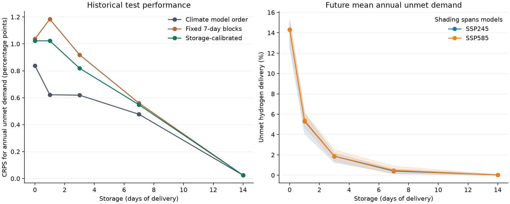

# Syracuse hydrogen reliability pilot

The storage-calibrated method improved the calibration score, then the climate-model ordering performed better on all five storage sizes in the historical test. The published-data comparison gave a closer estimate of nearby flash wind drought frequency, while solar changes still varied substantially across models.

## Historical and future hydrogen reliability

The pilot uses an illustrative 30 MW wind, 20 MW solar, and 25 MW electrolyzer plant delivering 2,700 kg/day near Syracuse. It uses one member each from ACCESS-CM2, MPI-ESM1-2-HR, and MRI-ESM2-0. Calibration chose to replace every eligible block with a three-day ERA5 analog. The mean calibration CRPS across the four tuning tank sizes fell from 0.628 to 0.572 percentage points. Each method used the same monthly wind and solar marginal distributions.

| Tank size in days of delivery | Model order test CRPS | Fixed seven-day blocks | Storage-calibrated |
| --- | ---: | ---: | ---: |
| 0 | 0.839 | 1.037 | 1.023 |
| 1 | 0.622 | 1.184 | 1.023 |
| 3 | 0.619 | 0.919 | 0.819 |
| 7, withheld during tuning | 0.477 | 0.560 | 0.548 |
| 14 | 0.0245 | 0.0245 | 0.0248 |

Test scores compare distributions of annual unmet demand in 2007–2014 and are in percentage points. Lower is better. At the withheld seven-day tank size, the storage-calibrated score was higher by 0.071 percentage points. A two-year moving-block bootstrap over the eight reference years gives a descriptive range of −0.002 to +0.151 percentage points for the difference. The test supports keeping climate-model order as the reference method for this pilot. [Scores](historical_scores.csv) · [Calibration grid](calibration_grid.csv) · [Test differences](test_crps_differences.csv)

The three-model mean unmet demand for a seven-day tank in 2041–2060 was **0.55% under SSP2-4.5** and **0.60% under SSP5-8.5** using climate-model order. The resampling method estimated **0.41%** and **0.48%**. In all three models and both scenarios, seven days was the smallest tested tank size meeting the 1% mean shortfall target with resampling. The target is a period-average measure for the illustrative plant. [Future results](future_summary.csv) · [Storage targets](storage_targets.csv)

Timing affects that estimate even when the monthly wind and solar values stay fixed. With three days of storage under SSP2-4.5, mean unmet demand was **2.28%** with climate-model order, **1.47%** after shuffling paired days within each month, and **2.55%** after circularly shifting solar within each month. Paired shuffling preserves same-day wind and solar combinations and eliminates much of their persistence. Shifting preserves the individual series within each month up to a wraparound boundary while perturbing their alignment. These interventions also alter aspects of the weather sequence at block boundaries. [Future results](future_summary.csv)

## Comparison with published drought data

The analysis uses the publisher's Figure 2 workbook, the closest available cell to Syracuse (43.5°N, 76.5°W), the paper's reference and future windows (1985–2014 and 2045–2074), and SSP2-4.5. [Lin et al. (2026)](https://doi.org/10.1038/s41558-026-02753-3) · [Comparison protocol](../benchmarks/README.md)

| Change in flash-drought frequency | Published nearby cell | Pilot model order | Pilot storage-calibrated |
| --- | ---: | ---: | ---: |
| Wind | +11.8% | +38.1% | +16.4% |
| Solar | −2.0% | +63.2% | +9.1% |

The storage-calibrated solar results range from −52.3% to +44.1% across the three models. Each model's historical count is small, so a few additional events can move the relative change substantially. The comparison shares the date windows, scenario, and event thresholds. The published data come from an 18-model gridded analysis with different capacity-factor calculations. Wu et al. provide a closer application comparison on hydrogen infrastructure, but their capacity-factor time series are available only by author request. [Model-level benchmark](flash_drought_model_comparison.csv) · [Benchmark summary](flash_drought_summary.csv) · [Wu et al. (2026)](https://doi.org/10.1016/j.xinn.2026.101303)

The contribution tested here is calibration of the dependence model across storage sizes while holding the wind and solar marginal distributions fixed. The findings apply to one site, one plant, a daily dispatch approximation, and three climate model runs. The study compares future scenarios and historical periods under those assumptions.

[Pipeline run manifest](run_manifest.json) · [External comparison manifest](flash_drought_manifest.json)
